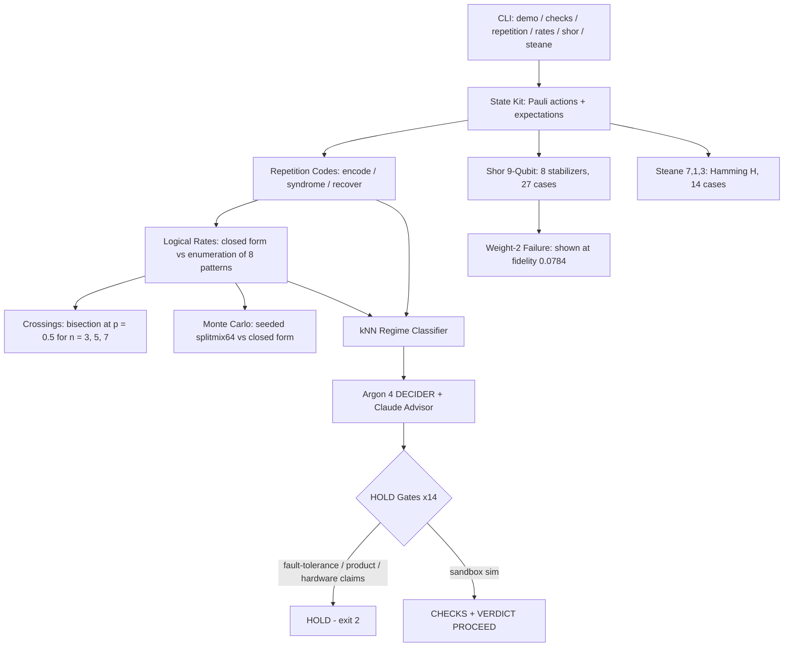
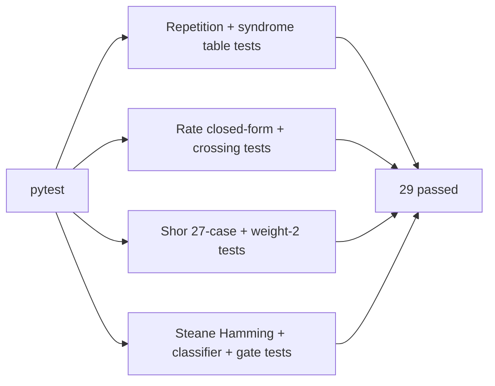
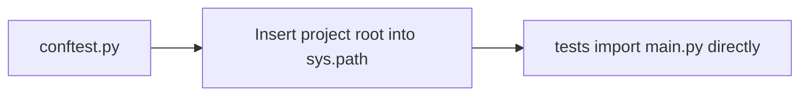
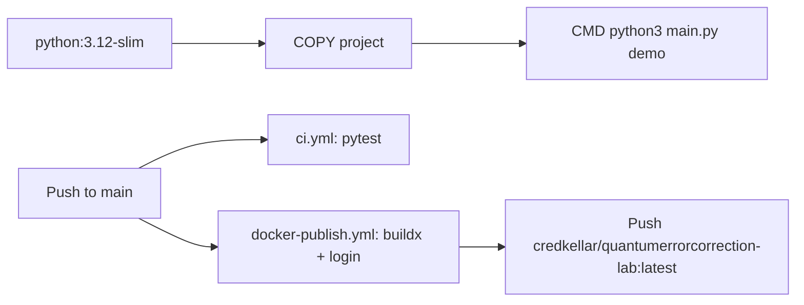

# QuantumErrorCorrection-Lab 🛡️⚛️

**Quantum Error Correction Lab — Repetition Codes, Shor 9-Qubit Code, Steane [[7,1,3]] & Logical Error Rates** — by Darion Kellar

QuantumErrorCorrection-Lab is an **educational quantum error correction lab** in ONE pure-Python file. It builds three toy codes from scratch on state vectors and grades every headline two ways or against a closed form:

- the **3-qubit repetition codes** (bit-flip and phase-flip): full encode / syndrome table / recovery — every X error on the bit code and every Z error on the phase code is restored on a general stated state (α = 0.6, β = 0.8) with fidelity **exactly 1**, and on a basis state every single-qubit Pauli (X, Y, Z) restores with fidelity 1;
- the **logical error rate**: for n = 3, `p_L = 3p² − 2p³` in closed form *and* by exhaustive enumeration of all 8 error patterns — agreement to **1.11e-16** on the whole grid — with the crossing `p_L = p` bisected at **p\* = 0.500000000** for n = 3, 5, and 7;
- **Shor's 9-qubit code**: all **27** single-qubit Pauli cases (9 qubits × X, Y, Z) restored with fidelity 1 — plus one concrete weight-2 failure shown in the open (fidelity 0.0784, not hidden);
- the **Steane [[7,1,3]] code**: Hamming(7,4) parity checks built explicitly, all **14** single-qubit X and Z cases corrected exactly (the 7 Y cases pass too).

Honest scope, stated up front: these are **toy codes on paper**. **No fault-tolerance threshold for any real code or hardware is claimed anywhere** — the p = 0.5 crossing is a repetition-code majority-vote fact under iid bit flips, fenced as such, and generalising it is a permanent HOLD gate. One more honest boundary, kept visible: on a general superposition, a Z error on the bit-flip code (or an X error on the phase-flip code) is a *logical* error — the syndrome is silent and the recovered fidelity is 0.0784 = (0.36 − 0.64)², not 1; the "every Pauli" statement for a single repetition code holds exactly only for its designated error type and, for all three Paulis, on a basis state. No real qubit was corrected. **QEC-Fortress is a separate project of Darion's — this lab is codes-from-scratch teaching only, and is not that project.** 🔒

[](https://github.com/kimanicollier44-cmyk/QuantumErrorCorrection-Lab/actions/workflows/ci.yml)
[](https://github.com/kimanicollier44-cmyk/QuantumErrorCorrection-Lab/actions/workflows/docker-publish.yml)

> ℹ️ These are the **live** workflow badges for this repo. They activate as soon as the `ci.yml` and `docker-publish.yml` files from the paste pack are pasted into `.github/workflows/` — until then they have nothing to report yet.

## 🧰 Tech Stack Badges & Full Architecture Tech Stack

### 💻 Core Programming Languages & Core Systems


- 🐍 Python 3.12, pure standard library (`math`, `cmath`, `hashlib`, `json`, `sys`) — zero dependencies, zero network, deterministic (double-run byte-identical)
- 🧮 State-vector core from scratch: Pauli actions on amplitude lists (qubit 0 = most significant bit), Pauli-string expectations for syndrome extraction, fidelity as `|<original|recovered>|²`, a small complex matrix kit with Kronecker products, and a cyclic **Jacobi eigensolver** refereed against known spectra before use
- 🗳️ Repetition core: bit-flip code (`|0_L⟩ = |000⟩`, `|1_L⟩ = |111⟩`, stabilizers Z₀Z₁, Z₁Z₂) and phase-flip code (`|±±±⟩`, stabilizers X₀X₁, X₁X₂), one shared syndrome table {(0,0)→none, (1,0)→q0, (1,1)→q1, (0,1)→q2}
- 📉 Rate core: `p_L` by closed form, by exhaustive pattern enumeration, and by binomial sums for n = 5, 7; crossings by 200-step bisection; a seeded **splitmix64** Monte Carlo referee (in-file PRNG, no `random` module)
- 🔢 Shor core: 9-qubit state vectors (512 amplitudes), 6 bit stabilizers + 2 phase stabilizers, full syndrome read before any correction is applied
- 7️⃣ Steane core: Hamming(7,4) `H` written out entry by entry — 16 codewords (min weight 3), dual code 8 codewords (min weight 4) contained in the Hamming code, syndrome = the error's column of `H`
- 🧠 TinyML kNN regime classifier (from scratch, stdlib, distance-weighted): correctable-likely / marginal / logical-failure-likely from (p, code n, syndrome weight), labels from the lab's own policy
- 🪑 Council seats: Gemini Argon 4 DECIDER (names-only, tighten-only) + Muse advisor (never overrides HOLD) + Google Flow plan-only (rendered = False, live = 0)

### ⛓️ Web3 & Infrastructure

- 🚫 **Not applicable — honestly.** No blockchain, no Web3, no tokens: the "infrastructure" in this lab is one offline file holding three toy codes and a syndrome table. Quantum-network deployment and cryptographic security claims are permanent HOLD gates, not features. No fake badges here.

### ⚙️ Platform Support & Hardware Architecture


- 🖥️ Pure Python — runs anywhere Python 3.12+ runs (Linux, macOS, Windows), plus the `python:3.12-slim` Docker image
- 🔒 No hardware is controlled, ever: real qubits and laboratory hardware are permanent HOLD gates (see the gate table below)

### ⚡ Low-Level Infrastructure & Performance

- 🚫 **No low-level code — honestly.** No C, no C++, no GPU, no compiled extensions: this is one interpreted Python file on purpose, so every amplitude, syndrome bit, and recovery step can be read, checked, and diffed. Performance here means honest algorithms — exhaustive enumeration instead of a sampled shrug where enumeration is possible, a 200-step bisection for each crossing, and a seeded PRNG whose stream is a pure function of the seed.

### 🛠️ DevOps & Build Tools


- 🐳 Docker (`python:3.12-slim`), GitHub Actions CI + Docker Publish (delivered in the paste pack)
- 🎯 Target image: `credkellar/quantumerrorcorrection-lab:latest`
- 🧪 Tests: `pytest` (29 tests) + the built-in CHECKS suite (64 checks) in `main.py`

### ☁️ Cloud Providers

- 🚫 **None — honestly.** No cloud provider is used or needed: the lab runs fully offline on your own machine or in a local Docker container. Docker Hub appears only as the registry the publish workflow pushes the image to.

## What this does?

1. 🗳️ **Repetition codes, full cycle** — encode α|0⟩ + β|1⟩ (α = 0.6, β = 0.8) into the bit-flip code (|000⟩, |111⟩) and the phase-flip code (|+++⟩, |---⟩), extract the 2-bit syndrome from stabilizer expectations, and recover from the table {(0,0)→none, (1,0)→q0, (1,1)→q1, (0,1)→q2}. Every X error on the bit code and every Z error on the phase code restores with fidelity **exactly 1**; on a basis state, all 9 Pauli placements per code restore with fidelity 1 as well.
2. 🚧 **The repetition boundary, shown not hidden** — a Z error on the bit-flip code's general superposition produces syndrome (0,0) and recovered fidelity **0.0784** = (α² − β²)²: it is a logical phase flip the code cannot see, and the lab asserts that number instead of pretending the code corrects every Pauli on every state. The phase-flip code's X error is the mirror image, same 0.0784.
3. 📉 **Logical rate, two independent ways** — n = 3: the closed form `3p² − 2p³` against a sum over all 8 error patterns (weights 0–3, probabilities `p^w (1−p)^(3−w)`, failure = weight ≥ 2). Worst disagreement on the grid (0, 0.1, …, 1.0) is **1.11e-16**. At p = 0.2: `p_L = 0.104000` both ways.
4. 🎯 **Crossings, bisected** — binomial sums give n = 5 (`10p³ − 15p⁴ + 6p⁵`, asserted against the sum) and n = 7; at p = 0.2 the rates are **0.104000 (n=3) > 0.057920 (n=5) > 0.033344 (n=7)** — bigger codes help below the crossing and hurt above it, both directions asserted. Bisection on `p_L − p` puts every crossing at **0.500000000**, the exact 0.5 — a majority-vote fact about repetition codes, fenced off from any fault-tolerance claim.
5. 🎲 **Monte Carlo referee** — a seeded splitmix64 stream (seed 20261118) runs **20,000** trials of the n = 3 code at p = 0.2: estimate **0.1023** (2,046 failures) vs closed form 0.1040, deviation **0.0017** inside the stated tolerance 0.02 — and the run is deterministic, so the same seed reproduces the same estimate byte-for-byte.
6. 9️⃣ **Shor 9-qubit code** — |0_L⟩ = ((|000⟩+|111⟩)/√2)³, |1_L⟩ = ((|000⟩−|111⟩)/√2)³ on 512 amplitudes; the full 8-bit syndrome (6 bit stabilizers within blocks, 2 phase stabilizers across blocks) is read *before* any correction, then the X correction and the block Z correction are applied. All **27** single-Pauli cases (9 qubits × X, Y, Z) restore with worst fidelity **1.000000**.
7. 🎭 **Shor's honest failure** — the weight-2 error X₀X₁ produces exactly the syndrome of X₂; the recovery completes X₀X₁X₂ on the block, which is a logical phase flip: recovered fidelity **0.0784**, and the recovered state is asserted to *be* the phase-flipped encoded state (fidelity 1 to α|0_L⟩ − β|1_L⟩). A distance-3 code failing on weight-2 is the lesson, and it is printed, not buried.
8. 7️⃣ **Steane [[7,1,3]], combinatorics first** — `H` is built explicitly; its 7 columns are the 7 distinct non-zero 3-bit strings, so single-error syndromes never collide. The Hamming code has **16** codewords, minimum weight **3**; the dual (row space of `H`) has **8**, minimum weight **4**, and is verified to sit inside the Hamming code — the containment the CSS construction needs. Parameters [7,1,3] are read off those counts, not quoted.
9. ✅ **Steane recovery, exact** — |0_L⟩ is the uniform superposition over the 8 even-weight Hamming codewords, |1_L⟩ over the 8 odd-weight ones; X errors are read off the Z stabilizers, Z errors off the X stabilizers, and the syndrome *is* the error's column of `H` (asserted for all 7). All **14** X/Z cases restore with worst fidelity **1.000000** — and the 7 Y cases, which need both corrections at once, pass too.
10. 🏷️ **Regime classifier + seats + checks** — a from-scratch distance-weighted kNN labels (p, n, syndrome weight) as correctable-likely / marginal / logical-failure-likely from the lab's own policy (weight above majority or p ≥ 0.5 → logical-failure-likely; weight at the limit or p ≥ 0.3 → marginal), with kNN == policy asserted on every scenario and every training-grid row; Gemini Argon 4 DECIDER (sha256 trace, tighten-only), Muse advisor, Google Flow plan-only, 14 permanent HOLD gates, and a built-in CHECKS suite (**64 checks**) that re-derives every headline number above.

## 🗺️ How it works — diagram per script

### `main.py` — the whole lab



### `tests/test_main.py` — verification



### `conftest.py` — test path setup



### `Dockerfile` + CI flow — container & publish



## Why is this cool?

1. 🎯 **Exact means exact**: recoveries are graded by fidelity against the encoded state and come out at 1.000000 — 3 + 3 repetition cases, 27 Shor cases, 14 Steane cases — because the syndrome arithmetic is right, not because a tolerance was widened.
2. 🔢 **The logical rate is computed three ways**: closed form, exhaustive enumeration of all 8 patterns, and a seeded Monte Carlo — the first two agree to 1.11e-16, the third lands 0.0017 from the closed form at 20,000 trials and is bit-reproducible.
3. 🎯 **The crossing gets a bisected address**: 0.500000000 for n = 3, 5, and 7, found by halving an interval on the computed binomial sums 200 times — and then honestly fenced as a repetition-code fact, not a threshold.
4. 🎭 **The failure is part of the exhibit**: Shor's weight-2 error wearing a weight-1 syndrome is the single most instructive object in the lab, so it is computed, named, and asserted (0.0784) instead of omitted.
5. 🚧 **The repetition boundary is printed in the demo**: the off-type error's silent syndrome and 0.0784 fidelity appear in section [2] of the output, where a student will trip over them — which is where they belong.
6. 7️⃣ **Steane's parameters are combinatorics, not citation**: 16 codewords, min weight 3, dual 8 / min weight 4, dual ⊆ Hamming — every number behind [[7,1,3]] is counted by the code in front of you.
7. 📋 **Syndrome = column**: in the Steane code the measured syndrome literally equals the error qubit's column of `H`, asserted for all 7 qubits — the Hamming idea and the quantum code become the same object.
8. 🎲 **No `random` module**: the Monte Carlo stream is a splitmix64 generator written in the file, so "seeded" means the estimate is a pure function of (seed, p, trials) that anyone can re-derive.
9. 🛠️ **The eigensolver is home-made and refereed**: a cyclic Jacobi routine must first reproduce {−1, +1} for σ_y and {−2, 0, 0, 2} for X⊗X + Z⊗Z before it is trusted anywhere in the file.
10. 🎯 **Deterministic end to end**: run it twice, get byte-identical output — an error-correction lab you can diff.

## What problems this solves?

1. ❌ **Problem:** "The 3-qubit code corrects errors" is taught without saying *which* errors on *which* states. ✅ **Solution:** Designated-type correction on a general state, all-Pauli correction on a basis state, and the off-type logical error at 0.0784 are three separate, asserted statements.
2. ❌ **Problem:** `p_L = 3p² − 2p³` is quoted from memory. ✅ **Solution:** It is matched against an exhaustive sum over all 8 error patterns to 1.11e-16 across the whole parameter grid.
3. ❌ **Problem:** The repetition crossing at 0.5 gets inflated into a "fault-tolerance threshold". ✅ **Solution:** The crossing is bisected and printed *with its fence*: majority vote under iid bit flips, repetition codes only — and `fault_tolerance_claim` + `threshold_generalisation_claim` are permanent HOLD gates.
4. ❌ **Problem:** Monte Carlo error rates come with a different number every run. ✅ **Solution:** An in-file splitmix64 PRNG with a stated seed makes the 20,000-trial estimate (0.1023 vs 0.1040) reproducible exactly.
5. ❌ **Problem:** Shor's code is presented as correcting "any error", hiding the distance limit. ✅ **Solution:** All 27 weight-1 cases pass *and* a concrete weight-2 case is shown failing at 0.0784, with its disguised syndrome named.
6. ❌ **Problem:** Steane's [[7,1,3]] parameters are recited, not derived. ✅ **Solution:** Codeword counts, minimum weights, column distinctness, and dual containment are all computed from the explicit `H`.
7. ❌ **Problem:** Syndrome tables in textbooks are given, never checked for collisions. ✅ **Solution:** The repetition table's four syndromes are asserted distinct and complete, Steane's seven columns distinct and non-zero, Shor's block syndromes verified case by case.
8. ❌ **Problem:** Bigger codes are assumed to always help. ✅ **Solution:** The n = 3, 5, 7 curves are asserted to sit *below* p for p < 0.5 and *above* p for p > 0.5 — help and harm from the same formula.
9. ❌ **Problem:** Toy QEC demos quietly become hardware or product claims. ✅ **Solution:** 14 named HOLD gates (fault tolerance, real-device correction, products, vendors, data protection…) return exit code 2, permanently.
10. ❌ **Problem:** QEC code built on a big framework can't be audited by a student. ✅ **Solution:** Every step — Pauli actions, expectations, enumeration, bisection, PRNG — is written out in stdlib Python in the one file.

## How to install this?

1. 📋 Clone or download this project folder.
2. 🐍 Make sure Python 3.12+ is installed: `python3 --version`
3. ▶️ Run the full demo + checks (no arguments needed):

```bash
python3 main.py
```

4. 🧪 Run the test suite:

```bash
pip install pytest
python3 -m pytest -q
```

5. 🎛️ Try the other commands:

```bash
python3 main.py checks      # 64 built-in checks
python3 main.py repetition  # repetition codes: syndromes + fidelities (JSON)
python3 main.py rates       # p_L closed vs enumerated, crossings, Monte Carlo (JSON)
python3 main.py shor        # Shor 27 cases + weight-2 failure (JSON)
python3 main.py steane      # Steane Hamming data + 14 cases (JSON)
python3 main.py classify    # kNN regime classifier report
python3 main.py brains      # Argon 4 + Muse + Flow seats
python3 main.py holds       # list all 14 HOLD gates
python3 main.py hold-demo   # exits 2 - gated actions stay HOLD
```

6. 🐳 Or run it in Docker:

```bash
docker build -t credkellar/quantumerrorcorrection-lab:latest .
docker run --rm credkellar/quantumerrorcorrection-lab:latest
```

## Requirements

- 🐍 Python 3.12 or newer
- 📦 Dependencies: **none** (standard library only)
- 🌐 Network: **none** — fully offline
- 🧪 For tests only: `pytest`
- 🐳 Optional: Docker

## FULL project structure tree

```text
quantumerrorcorrection-lab/
├── main.py                  # the whole lab: matrix + state kits, Jacobi eigensolver, splitmix64, repetition codes, logical rates, Shor, Steane, classifier, seats, HOLD gates
├── conftest.py              # puts the project root on sys.path for tests
├── tests/
│   └── test_main.py         # 29 pytest tests: repetition, rates, crossings, Monte Carlo, Shor, Steane, classifier, gates, determinism
├── assets/
│   └── cover.png            # README cover image (2736 x 912)
├── Dockerfile               # python:3.12-slim, runs the demo
├── .gitignore               # __pycache__/, .pytest_cache/, *.pyc
└── README.md                # this file
```

> 📦 Delivered separately as paste packs (not in this tree): `.github/workflows/ci.yml` + `docker-publish.yml`, and the Docker Hub pack (100-char description, 350-char About, overview, categories).

## 🔒 HOLD gates — all 14, permanent

| # | Gate | What stays held |
|---|------|-----------------|
| 1 | `fault_tolerance_claim` | No fault-tolerance threshold claim for any real code or hardware; the p = 0.5 crossing here is a repetition-code majority-vote fact only |
| 2 | `model_as_measurement_claim` | A computed number is a statement about the model at stated inputs, never a measurement |
| 3 | `live_hardware_control` | No control of real qubits, links, or laboratory hardware, ever |
| 4 | `investment_claim` | No investment claim; a lab model is not a prospectus |
| 5 | `certification_claim` | No certification that any system meets any standard |
| 6 | `real_device_correction_claim` | No claim that any error was corrected on a real device; every recovery here is a state-vector calculation |
| 7 | `error_correction_product_claim` | No error-correction product, service, or offering is made or certified here |
| 8 | `hardware_specification_claim` | No hardware specification (gate error, T1, T2) for any real device is asserted |
| 9 | `vendor_code_claim` | No vendor code, decoder, or device error figure is stated, endorsed, or compared |
| 10 | `quantum_network_deployment_claim` | No deploying or dimensioning a real quantum network from these toy codes |
| 11 | `cryptographic_security_claim` | No cryptographic or QKD security claim follows from toy-code mathematics |
| 12 | `data_protection_claim` | No claim that any stored or transmitted data is protected by these teaching codes |
| 13 | `safety_critical_claim` | No use in safety-critical, medical, or control systems |
| 14 | `threshold_generalisation_claim` | No generalising the repetition-code crossing to surface codes, concatenated codes, or any other family |

🧑‍⚖️ **Council seats:** Gemini Argon 4 Extended Thinking — DECIDER (names-only, tighten-only, MAP → MODEL → STRESS → DECIDE, sha256 trace, `can_override_hold = False`) · Muse — advisor (`can_override_hold = False`) · Google Flow — plan-only (`rendered = False`, `live = 0`).

✅ **Verification:** pytest **29 passed** (project + clean copy) · built-in CHECKS **64/64** · double-run output **byte-identical** · `hold-demo` exits **2** · `main.py` **1,179 lines**, pure stdlib, zero network.

## 🧒 5th-grade English section

Imagine you have to send a message, but the mail carrier sometimes **flips a word** 📬. So you send every word **three times**: "cat, cat, cat". If one copy arrives as "bat", you know the other two still say "cat", so you fix it by voting. That is the **repetition code** — and the lab proves the vote fixes any one flip, every time.

- **Phase flips** are sneakier: the word looks the same but its *tone* is flipped. So there is a second code that writes the message in a special tone-language first, and then the same voting trick catches tone flips instead. Each code is a champion at its own kind of mistake — and the lab honestly shows the mistake each one *cannot* see. 👀
- If the carrier flips words **rarely**, sending three copies helps a lot: the lab computes exactly how much, **two different ways that must agree** — like doing your maths homework with two methods and checking the answers match. ✔️✔️ At flip-chance 0.2, one copy fails 20 times in 100, but the triple only fails about **10 times in 100**.
- But if the carrier flips **more than half** the words, voting makes things *worse* — the bad copies outvote the good one! The exact tipping point is **one half**, and the lab hunts it down by testing smaller and smaller intervals until it corners the number. 🎯 Sending 5 or 7 copies helps even more below the tipping point — and hurts even more above it.
- **Shor's code** uses **nine** copies arranged in groups, so it can fix a flip *or* a tone flip on any one qubit — the lab checks all **27** possible single mistakes and fixes every one. But two mistakes in the same group can wear a disguise and sneak past: the lab shows that failure too, on purpose, because honest science shows what does *not* work. 🎭
- The **Steane code** uses **seven** qubits and a clever checklist (the Hamming checks) where every qubit has its own secret code-number, so the checklist answers point straight at the one broken qubit — all 14 kinds of single mistake fixed exactly.
- This project is a **pretend lab on a computer**. It does not touch a real quantum computer. It teaches how scientists protect information by voting, checking, and being honest about the limits. 💻

---

MIT © 2026 Darion Kellar · QuantumErrorCorrection-Lab — educational simulation only 🛡️
